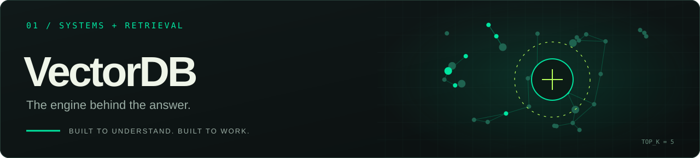
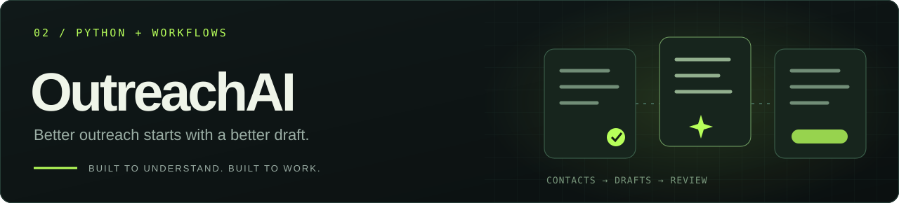
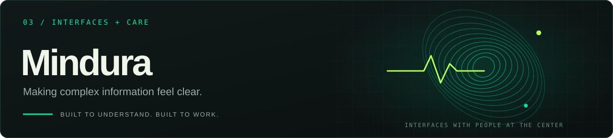
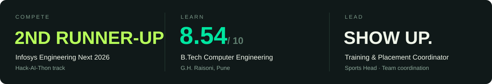
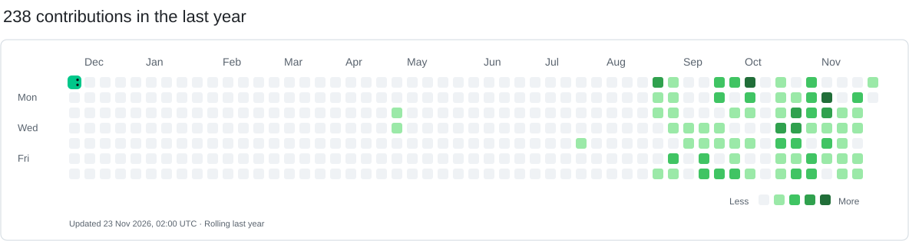

<!-- Custom portfolio visuals are in assets/profile/. -->

  

  

**C++ at the core. AI at the edge. Curiosity everywhere.**

 

I'm **Yuvraj Singh**, a Computer Engineering student in Pune. I build in C++ and Python, and I like getting below the surface: how vectors are indexed, how retrieval works, and how useful AI systems come together.

## Selected work

### 01 — VectorDB

**C++ · Vector search · RAG · Ollama**

A retrieval engine built from the fundamentals. It connects custom vector search, document retrieval, and locally running LLMs.

<strong>Inside the engine</strong>

- Brute-force search, KD-Trees, and HNSW indexing.
- Cosine, Euclidean, and Manhattan distance.
- Vector CRUD, document ingestion, and similarity search.
- Ollama embeddings and Llama 3.2 for a local retrieval-to-answer pipeline.

[Explore the engine ↗](https://github.com/yuviii0509/VectorDB)

 

### 02 — OutreachAI

**Python · Streamlit · Gemini · SQLite**

A local-first workspace for thoughtful outreach. Import and validate contacts, create personalized drafts, review them, and keep campaign state in one place.

<strong>Inside the workflow</strong>

- Contact import, email validation, and duplicate detection.
- Template-based drafts with optional Gemini personalization.
- Preview drafts and record approval status.
- SQLite storage for local campaign history and state.

[Explore the workspace ↗](https://github.com/yuviii0509/OutreachAI)

 

### 03 — Mindura

**HTML · CSS · JavaScript · Interface design**

A cognitive-health interface prototype, with screening pages, dashboards, progress reports, and caregiver flows. My focus was making complex information easier to navigate.

<strong>Inside the interface</strong>

- Screening and assessment interfaces.
- Dashboards and progress-report views.
- Caregiver access and consultation-booking flows.

[Explore the prototype ↗](https://github.com/yuviii0509/Mindura)

 

**Also built: NagarSetu** — a civic grievance reporting platform exploring GPS verification, geofencing, duplicate detection, and English, Hindi, and Marathi localization.

## My toolbox

  

 

**Working deeper on:** data structures and algorithms, retrieval systems, embeddings, and agentic AI.

## Beyond the code

 

- **2nd Runner-Up** — Infosys Engineering Next 2026, Hack-AI-Thon track.
- **8.54 / 10 CGPA** — B.Tech Computer Engineering, G.H. Raisoni, Pune.
- **Leadership** — Training & Placement Student Coordinator and Sports Head.

I bring the same energy to a hackathon, a placement drive, and a team project: understand the problem, take responsibility, and keep moving.

---

<h2 align="center">💻 LeetCode Journey</h2>

### CONSISTENCY OVER QUANTITY

  
  
  

 

  

### 🟢 Submission Activity

  

**Problem Solving in C++**

*Every problem is another opportunity to improve.*

 

---

<h2 align="center">🐍 GitHub Contribution Snake</h2>

My GitHub contribution calendar, animated and automatically refreshed every 30 minutes.

<picture>
  <source media="(prefers-color-scheme: dark)" srcset="https://raw.githubusercontent.com/yuviii0509/yuviii0509/output/github-snake-live-dark.svg" />
  <source media="(prefers-color-scheme: light)" srcset="https://raw.githubusercontent.com/yuviii0509/yuviii0509/output/github-snake-live.svg" />
  
</picture>

---

  

[GitHub](https://github.com/yuviii0509) · [LinkedIn](https://www.linkedin.com/in/yuvraj-singh0509/) · [LeetCode](https://leetcode.com/u/yuviii_0105/) · [Email](mailto:yuvraj495051@gmail.com)

 

Learn with intent. Build with care. Keep improving.

